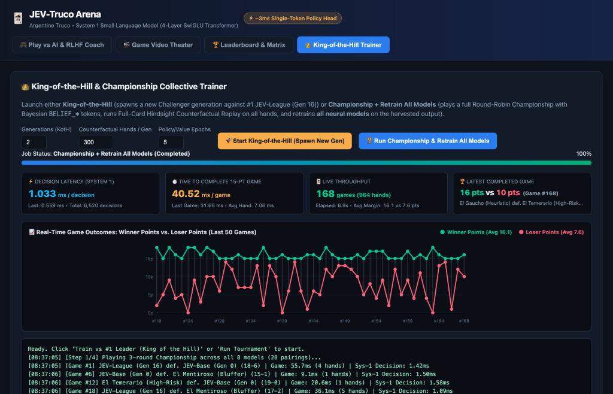
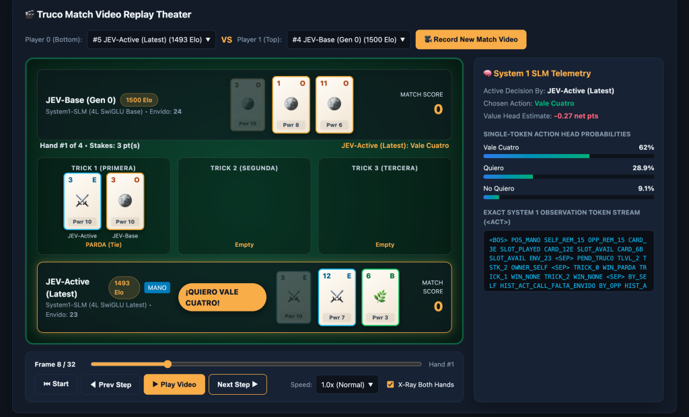

# 🃏 JEV-Truco: System 1 Small Language Model & Bayesian Tactical Arena for Argentine Truco

[-f5b942?style=for-the-badge)](https://meirm.github.io/truco-slm/)
[](./webui/index.html)

**JEV-Truco** is a full 2-player **Argentine Truco** engine (40-card Spanish deck, *Envido / Real Envido / Falta Envido*, *"El Envido está primero"*, *"Son buenas"*, *Truco / Retruco / Vale Cuatro*, and *Parda* tie-breaker rules) powered by a **System 1 Small Language Model (`System1TrucoSLM`)** that selects actions and estimates expected value in a **single forward pass (`~1.0 ms` per decision, zero Chain-of-Thought tokens)**.

👉 **[Open the Live Interactive App (`index.html`)](https://meirm.github.io/truco-slm/)** *(works directly on **GitHub Pages `github.io`** in static demo mode, or connected to `server.py` locally for live PyTorch RLHF training!)*

---

## 🎬 Two Bots Playing Against Each Other (`JEV-Active` vs. `JEV-Base`)

Below is a live capture from the **[Interactive Video Replay Theater](./index.html)** showing two System-1 SLM bots (`#5 JEV-Active` vs. `#4 JEV-Base`) battling across a high-stakes hand:
1. **Deal & Envido Phase**: `JEV-Active` (Mano, holding `3E, 12E, 6B`) opens with a psychological *Falta Envido* probe; `JEV-Base` (`3O, 1O, 11O`, 24 Envido) declines (*No Quiero*).
2. **Trick 1 (*Primera* — Parda)**: `JEV-Active` leads `3 de Espada` (`Pwr 10`) and `JEV-Base` ties with `3 de Oro` (`Pwr 10`) for a **Parda** on Primera.
3. **Full Truco Escalation**: With `12 de Espada` vs. `1 de Oro` in *Segunda*, the bots escalate **Truco → Retruco → ¡Quiero Vale Cuatro!** while the bottom telemetry panel streams the exact `<BOS> ... <ACT>` token sequence, Bayesian opponent belief tokens (`BELIEF_WIN_*`, `BELIEF_THREAT_*`, `BELIEF_ENV_*`), and single-pass policy probabilities.


---

## 📸 Visual Tour & Key Features

### 1. 🎮 Play vs. AI, Bayesian Card Reading & Human-in-the-Loop RLHF Coach
Play 15-point matches against any model on the Leaderboard—or enable **🕵️ Hide Opponent Identity (Mystery Opponent)** to play blind and reveal which personality bot you faced after the match.
- **"Son buenas" Rule**: Mano always declares their Envido score first; if Pie loses the Envido, Pie says *"Son buenas"* without revealing their score or unplayed cards.
- **Joint Envido + Played-Card Deduction (`envido_hypotheses`)**: Once an opponent declares their Envido points and plays a card (e.g., declares **`21`** as Mano and plays **`12 de Espada`** `12E`), the Bayesian tracker decomposes their remaining hidden cards into concrete tactical branches:
  1. **Links with `12E` (`60%`)**: Holds **`1 de Espada` (`1E`)** + 1 free card (which could include `1 de Basto` `1B` or a `3`).
  2. **Hidden Basto Pair (`13%`, `12E` loose)**: Holds **`1B` + `10B/11B/12B`** (two strong Truco cards alongside `12E`).
  3. **Hidden Copa/Oro Pair (`27%`, `12E` loose)**: Holds **`1O` or `1C` + `10/11/12`** (worth much less in Truco).
- **Direct RLHF Action Critique**: Approve (`👍`) or override (`👎 + Better Action`) any AI move and click **🔥 Fine-Tune AI on Feedback Now**—plus automatic **End-of-Hand Hindsight Counterfactual Replay** once all 6 cards are known.


---

### 2. 🏆 8-Model Elo Leaderboard, Tactical Personalities & Roster Pruning
The arena ranks 4 core architectures alongside 4 specialized tactical personalities modulated at the logit level:
- **El Mentiroso (`jev_bluffer`)**: High-frequency strategic bluffer on weak hands & low Envido counts.
- **El Zorro (`jev_phisher`)**: Slow-plays monster hands on Trick 0 (*"Achique"* bait with weakest card) to snap-trap opponents on Trick 1/2.
- **El Comisario (`jev_sheriff`)**: Bayesian bluff-catcher and trap-smeller (`p_bluff_suspect` & `p_trap_suspect`).
- **El Temerario (`jev_kamikaze`)**: Relentless maximum-pressure stakes escalator.

Includes interactive **✂️ Roster Pruning** controls in the UI (`Keep Top K`, `Keep Core 8`, `Drop < 50% Win Rate`, per-row `🗑️` removal, and `Restore All`).


---

### 3. 👑 King-of-the-Hill & Championship Collective Retrainer (Real-Time Telemetry)
Launch **King-of-the-Hill** (spawns a new Challenger generation against #1) or **Championship + Retrain All Models** (runs a full round-robin duplicate championship, applies full-card hindsight counterfactual replay to every hand, and retrains all neural models on the harvested dataset).
- Streams **real-time KPI cards** (`~1.03 ms` per System-1 decision, `~40.5 ms` per 15-point match) and a live **Winner Points vs. Loser Points** SVG chart above the console log.



---

### 4. 🎬 Bot Match Video Replay Theater & System-1 Telemetry Inspector
Select any two models, simulate multi-hand duplicate matchups, and scrub frame-by-frame through every deal, bet, speech bubble, and trick with full visibility into the model's 162-token `<ACT>` prompt and top-5 action probabilities.



---

## 🗂️ Repository Structure

| File | Description |
| :--- | :--- |
| [`index.html`](./index.html) / [`webui/index.html`](./webui/index.html) | Standalone React 19 Web UI (works on **GitHub Pages `github.io`** via [`docs/data/static_bundle.json`](./docs/data/static_bundle.json) and with [`server.py`](./server.py) locally) |
| [`server.py`](./server.py) | Multi-threaded REST & Web UI server (`/api/play/*`, `/api/leaderboard/*`, `/api/train/*`, `/api/simulate`) |
| [`main.py`](./main.py) | CLI entry point for `--mode train`, `--mode league`, `--mode challenge-leader`, `--mode championship-retrain`, `--mode leaderboard`, and `--mode play` |
| [`truco/engine.py`](./truco/engine.py) | Complete 2-player Argentine Truco rules engine (40 cards, 14 power tiers, Envido chain, *"El Envido está primero"*, *"Son buenas"*, Truco chain, Parda rules) |
| [`truco/tokenizer.py`](./truco/tokenizer.py) | 162-token domain vocabulary serializer + Bayesian hidden-card belief tracker (`compute_opponent_belief`) and Envido→Truco hypothesis generator |
| [`truco/model.py`](./truco/model.py) | `System1TrucoSLM`: 4-layer causal Transformer (`RMSNorm` + `SwiGLU` + masked policy head + scalar value head) |
| [`truco/leaderboard.py`](./truco/leaderboard.py) | Persistent Elo leaderboard, Roster Pruning manager, and Tactical Personality logit modulator (`act_with_personality`) |
| [`truco/arena.py`](./truco/arena.py) | Dual-instance league trainer, King-of-the-Hill gauntlet, and Championship + Hindsight collective retrainer |
| [`truco/rlhf.py`](./truco/rlhf.py) | Interactive Human-vs-AI session manager, Mystery Opponent masking, and online RLHF + Hindsight Replay trainer |
| [`tests/test_truco.py`](./tests/test_truco.py) | 12-test unit test suite covering Argentine Truco rules, Bayesian Envido+Card deduction, personalities, and leaderboard pruning |

---

## 🚀 Quick Start (Local Server & CLI)

### 1. Install Dependencies
```bash
python3 -m venv .venv
.venv/bin/pip install torch numpy
```

### 2. Launch the Interactive Web UI & Video Replay Server
```bash
.venv/bin/python server.py --port 8090
```
Open **`http://127.0.0.1:8090`** in your browser.

### 3. Run Unit Tests
```bash
.venv/bin/python -m unittest discover -s tests -v
```

### 4. Common CLI Workflows (`justfile` or `main.py`)
```bash
# Print current 8-model Leaderboard & Head-to-Head Matrix
.venv/bin/python main.py --mode leaderboard --tournament-rounds 0

# Run a 5-round duplicate tournament across all active models
.venv/bin/python main.py --mode leaderboard --tournament-rounds 5 --reset-leaderboard

# Run a Championship across all models + Retrain all neural checkpoints on Hindsight Replay
.venv/bin/python main.py --mode championship-retrain --championship-rounds 2 --epochs 5
```

---

## 🌐 Deploying to GitHub Pages (`github.io`)

1. Push this repository to GitHub:
   ```bash
   git add .
   git commit -m "Release JEV-Truco System 1 SLM & Interactive Web UI"
   git push -u origin master
   ```
2. In your GitHub repository, navigate to **Settings → Pages**.
3. Under **Build and deployment**, select **Deploy from a branch**, choose **`master`** (or `main`) and **`/ (root)`**, and click **Save**.
4. Your interactive app will be live at **`https://<your-username>.github.io/<repo-name>/`** (serving [`index.html`](./index.html) with pre-bundled Championship replays and Leaderboard data from [`docs/data/static_bundle.json`](./docs/data/static_bundle.json)).
