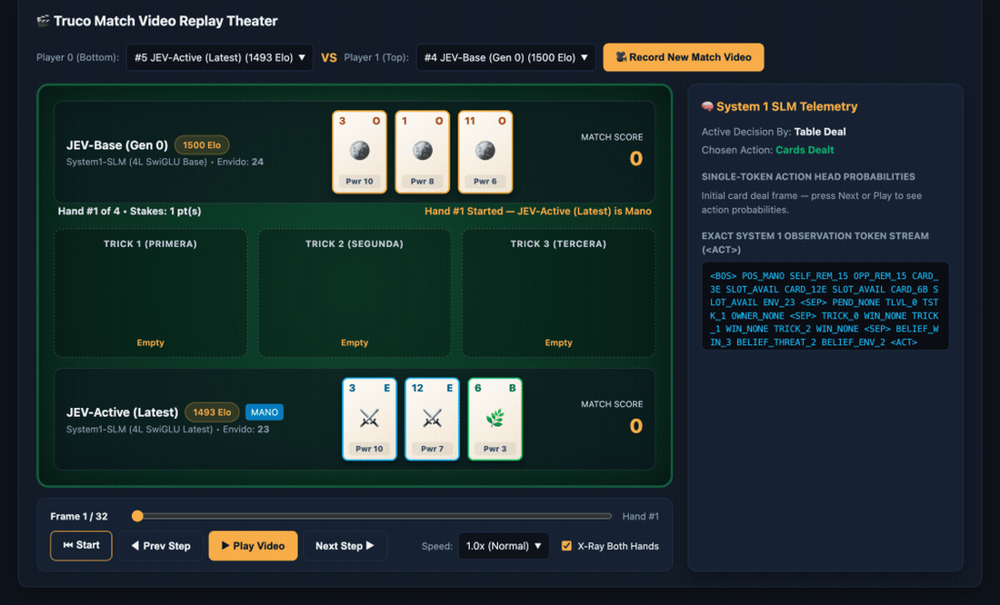
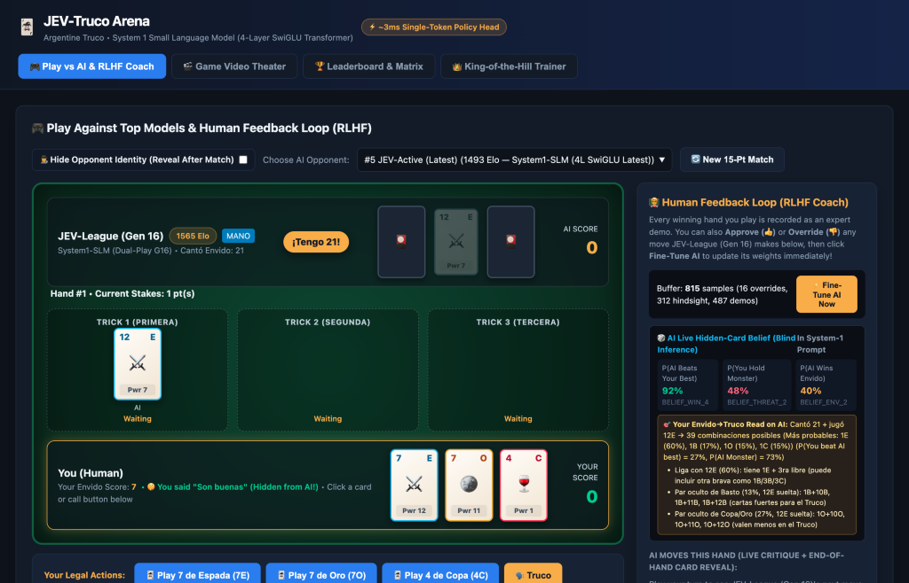
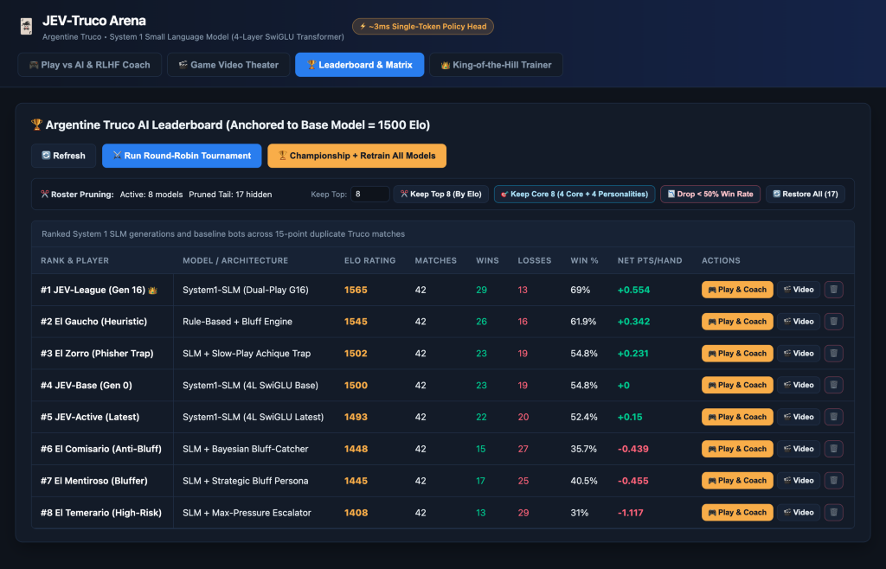

# 🃏 JEV-Truco: Modelo de Lenguaje Pequeño System 1 y Arena Táctica Bayesiana para Truco Argentino

[-f5b942?style=for-the-badge)](https://meirm.github.io/truco-slm/)
[](./webui/index.html)

**JEV-Truco** es un motor completo para **Truco Argentino** de 2 jugadores (baraja española de 40 cartas, reglas de *Envido / Real Envido / Falta Envido*, *«El Envido está primero»*, *«Son buenas»*, *Truco / Retruco / Vale Cuatro* y desempate por *Parda*), impulsado por un **modelo de lenguaje pequeño System 1 (`System1TrucoSLM`)** que elige acciones y estima el valor esperado en **una sola pasada hacia delante (`~1.0 ms` por decisión, sin tokens de cadena de pensamiento)**.

👉 **[Abrir la aplicación interactiva en vivo (`index.html`)](https://meirm.github.io/truco-slm/)** *(funciona directamente en **GitHub Pages `github.io`** en modo de demostración estática, o conectada localmente a `server.py` para entrenar RLHF en vivo con PyTorch).*

---

## 🎬 Dos bots juegan entre sí (`JEV-Active` vs. `JEV-Base`)

A continuación se muestra una captura en vivo del **[teatro interactivo de repeticiones](./index.html)**, donde dos bots SLM System-1 (`#5 JEV-Active` vs. `#4 JEV-Base`) se enfrentan en una mano de alto riesgo:
1. **Reparto y fase de Envido**: `JEV-Active` (Mano, con `3E, 12E, 6B`) abre con una jugada psicológica de *Falta Envido*; `JEV-Base` (`3O, 1O, 11O`, 24 de Envido) no acepta (*No Quiero*).
2. **Primera baza (*Primera* — Parda)**: `JEV-Active` sale con el `3 de Espada` (`Pwr 10`) y `JEV-Base` empata con el `3 de Oro` (`Pwr 10`), dejando la **Parda** en Primera.
3. **Escalada completa del Truco**: Con el `12 de Espada` frente al `1 de Oro` en *Segunda*, los bots suben la apuesta de **Truco → Retruco → ¡Quiero Vale Cuatro!**, mientras el panel inferior de telemetría muestra la secuencia exacta de tokens `<BOS> ... <ACT>`, los tokens de creencia bayesiana sobre el oponente (`BELIEF_WIN_*`, `BELIEF_THREAT_*`, `BELIEF_ENV_*`) y las probabilidades de la política de una sola pasada.



---

## 📸 Recorrido visual y funciones principales

### 1. 🎮 Juega contra la IA, lectura bayesiana de cartas y entrenador RLHF con intervención humana
Juega partidas a 15 puntos contra cualquier modelo de la clasificación, o activa **🕵️ Ocultar identidad del oponente (oponente misterioso)** para jugar sin saber quién es y descubrir después de la partida a qué bot de personalidad te enfrentaste.
- **Regla de «Son buenas»**: Mano siempre declara primero sus puntos de Envido; si Pie pierde el Envido, dice *«Son buenas»* sin revelar su puntuación ni las cartas que aún no ha jugado.
- **Deducción conjunta de Envido y cartas jugadas (`envido_hypotheses`)**: Cuando el oponente declara sus puntos de Envido y juega una carta (por ejemplo, declara **`21`** como Mano y juega el **`12 de Espada`** `12E`), el rastreador bayesiano descompone las cartas ocultas que le quedan en escenarios tácticos concretos:
  1. **Combinación con `12E` (`60%`)**: Tiene el **`1 de Espada` (`1E`)** y una carta libre (que podría ser el `1 de Basto` `1B` o un `3`).
  2. **Pareja oculta de Bastos (`13%`, `12E` sin pareja)**: Tiene **`1B` + `10B/11B/12B`** (dos cartas fuertes para el Truco junto al `12E`).
  3. **Pareja oculta de Copas/Oros (`27%`, `12E` sin pareja)**: Tiene **`1O` o `1C` + `10/11/12`** (mucho menos valiosas en el Truco).
- **Evaluación directa de acciones mediante RLHF**: Aprueba (`👍`) o corrige (`👎 + Better Action`) cualquier jugada de la IA y pulsa **🔥 Fine-Tune AI on Feedback Now**. Además, al conocerse las 6 cartas, se ejecuta automáticamente una **revisión contrafactual retrospectiva al final de la mano**.



---

### 2. 🏆 Clasificación Elo de 8 modelos, personalidades tácticas y selección del equipo
La arena clasifica 4 arquitecturas principales junto con 4 personalidades tácticas especializadas, moduladas en el nivel de los logits:
- **El Mentiroso (`jev_bluffer`)**: farolea estratégicamente con mucha frecuencia cuando tiene malas cartas y pocos puntos de Envido.
- **El Zorro (`jev_phisher`)**: juega con cautela manos excelentes en la primera baza (*«Achique»*, usando la carta más débil como señuelo) para atrapar al rival en la segunda o tercera baza.
- **El Comisario (`jev_sheriff`)**: detecta faroles y trampas mediante inferencia bayesiana (`p_bluff_suspect` y `p_trap_suspect`).
- **El Temerario (`jev_kamikaze`)**: sube las apuestas sin descanso para ejercer la máxima presión.

La interfaz incluye controles interactivos para **✂️ seleccionar los modelos del equipo** (`Keep Top K`, `Keep Core 8`, `Drop < 50% Win Rate`), quitar modelos con el botón `🗑️` de cada fila y usar `Restore All` para restaurarlos todos.



---

### 3. 👑 Rey de la colina y reentrenador colectivo del campeonato (telemetría en tiempo real)
Inicia **Rey de la colina** (crea una nueva generación de Retadores para enfrentarse al número 1) o **Campeonato + reentrenar todos los modelos** (organiza un campeonato completo de todos contra todos con partidas duplicadas, aplica una reproducción contrafactual retrospectiva con todas las cartas a cada mano y vuelve a entrenar todos los modelos neuronales con los datos recopilados).
- Muestra **indicadores KPI en tiempo real** (`~1.03 ms` por decisión de System-1, `~40.5 ms` por partida a 15 puntos) y un gráfico SVG dinámico de **puntos del ganador frente a puntos del perdedor** sobre el registro de la consola.


---

### 4. 🎬 Teatro de repeticiones de partidas de bots e inspector de telemetría System-1
Selecciona dos modelos, simula enfrentamientos duplicados de varias manos y avanza fotograma a fotograma por cada reparto, apuesta, diálogo y baza, con visibilidad completa del prompt `<ACT>` de 162 tokens del modelo y de las cinco acciones más probables.


---

## 🗂️ Estructura del repositorio

| Archivo | Descripción |
| :--- | :--- |
| [`index.html`](./index.html) / [`webui/index.html`](./webui/index.html) | Interfaz web independiente en React 19 (funciona en **GitHub Pages `github.io`** mediante [`docs/data/static_bundle.json`](./docs/data/static_bundle.json) y localmente con [`server.py`](./server.py)) |
| [`server.py`](./server.py) | Servidor REST e interfaz web multihilo (`/api/play/*`, `/api/leaderboard/*`, `/api/train/*`, `/api/simulate`) |
| [`main.py`](./main.py) | Punto de entrada CLI para `--mode train`, `--mode league`, `--mode challenge-leader`, `--mode championship-retrain`, `--mode leaderboard` y `--mode play` |
| [`truco/engine.py`](./truco/engine.py) | Motor completo de reglas de Truco Argentino para 2 jugadores (40 cartas, 14 niveles de fuerza, cadena de Envido, *«El Envido está primero»*, *«Son buenas»*, cadena de Truco y reglas de Parda) |
| [`truco/tokenizer.py`](./truco/tokenizer.py) | Serializador de vocabulario de dominio de 162 tokens y rastreador bayesiano de cartas ocultas (`compute_opponent_belief`), además de generador de hipótesis de Envido a Truco |
| [`truco/model.py`](./truco/model.py) | `System1TrucoSLM`: Transformer causal de 4 capas (`RMSNorm` + `SwiGLU` + capa de política enmascarada + capa de valor escalar) |
| [`truco/leaderboard.py`](./truco/leaderboard.py) | Clasificación Elo persistente, gestor de selección de modelos del equipo y modulador de logits de personalidad táctica (`act_with_personality`) |
| [`truco/arena.py`](./truco/arena.py) | Entrenador de ligas con dos instancias, torneo Rey de la colina y reentrenador colectivo del campeonato con retrospectiva |
| [`truco/rlhf.py`](./truco/rlhf.py) | Gestor de sesiones interactivas Humano contra IA, ocultación de identidad del oponente y entrenador en línea RLHF + reproducción retrospectiva |
| [`tests/test_truco.py`](./tests/test_truco.py) | Suite de 12 pruebas unitarias sobre reglas del Truco Argentino, deducción bayesiana de Envido y cartas, personalidades y selección del equipo |

---

## 🚀 Inicio rápido (servidor local y CLI)

### 1. Instalar dependencias
```bash
python3 -m venv .venv
.venv/bin/pip install torch numpy
```

### 2. Iniciar la interfaz web interactiva y el servidor de repeticiones de video
```bash
.venv/bin/python server.py --port 8090
```
Abre **`http://127.0.0.1:8090`** en el navegador.

### 3. Ejecutar las pruebas unitarias
```bash
.venv/bin/python -m unittest discover -s tests -v
```

### 4. Flujos de trabajo CLI habituales (`justfile` o `main.py`)
```bash
# Mostrar la clasificación actual de 8 modelos y la matriz de enfrentamientos
.venv/bin/python main.py --mode leaderboard --tournament-rounds 0

# Ejecutar un torneo duplicado de 5 rondas entre todos los modelos activos
.venv/bin/python main.py --mode leaderboard --tournament-rounds 5 --reset-leaderboard

# Organizar un campeonato con todos los modelos y reentrenar los checkpoints neuronales con la reproducción retrospectiva
.venv/bin/python main.py --mode championship-retrain --championship-rounds 2 --epochs 5
```
